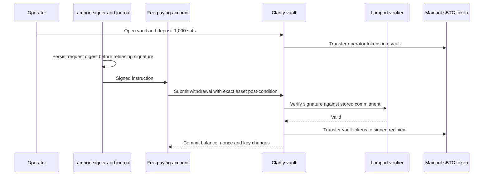

# Mainnet sBTC vault with Lamport withdrawal authorization

Draft for Engineering review - 15 October 2026

## 1. Summary

**Execution update - 15 October 2026.** The experimental mainnet demo completed: 1,000 sats of official sBTC were withdrawn with one Lamport authorization. All seven transactions passed six canonical Stacks block confirmations. Fees totaled 4.114578 STX against the 20 STX cap. The vault's sBTC balance is zero, its nonce is 1 and the planned successor is installed. See the [withdrawal transaction](https://explorer.hiro.so/txid/0xb983fa37d30d5ece2c2d3d539885cf5d6f2394245a733d76820a6fa9ca6a5b97?chain=mainnet).

Deploy a Clarity vault that holds a small amount of mainnet sBTC and releases it only after verifying a Lamport one-time signature over the withdrawal instruction. Execute one successful withdrawal, publish its transaction and contract evidence, and stop using the demo vault.

We propose adapting the existing testnet vault rather than introducing a new custody architecture. The vault stores a commitment to the signing key and a nonce. An off-chain signer approves a specific amount, recipient and successor key; a separate ordinary Stacks account pays the fee and submits the instruction. The contract verifies the signature, updates its state and transfers sBTC atomically.

The implementation uses existing SHA-256 and contract-call capabilities. It requires three contract deployments, vault creation, an sBTC deposit, submitter funding and the showcased withdrawal. No consensus change is proposed. The main costs are the roughly 19 KB carrying transaction, one-time-key handling and deployment fees.

## 2. Motivation

An ordinary Stacks account authorizes transactions with an elliptic-curve key. A sufficiently capable quantum attacker could break that authorization. A smart contract can impose a separate spending rule on assets it holds: possession of an ordinary account key is insufficient to withdraw if the contract also requires a valid hash-based authorization.

This demonstration tests that rule for mainnet sBTC. It produces a concrete result while Engineering separately evaluates broader changes to transaction signing, signers and Bitcoin dependencies. Lamport is the proposed scheme for this demo; section 3.3 explains the choice and its tradeoff. It does not select the signature scheme for future protocol upgrades.

### 2.1 Goals

- Deposit and withdraw 1,000 sats of mainnet sBTC (0.00001000 sBTC).
- Bind every withdrawal authorization to one chain, contract, vault, nonce, asset, amount, recipient and successor key.
- Demonstrate that a separate submitting account cannot redirect or replay an authorized withdrawal.
- Preserve one-time-key state across retries and process restarts.
- Produce reproducible source, transaction, transfer, state-change and cost evidence.

### 2.2 Non-goals

We are not building a public deposits product, dApp, wallet integration, recovery service or general-purpose account abstraction. This is an sBTC token transfer on Stacks, not an sBTC redemption into native Bitcoin. The design does not change ordinary transaction signing, Stacks block authorization or the security of sBTC's Bitcoin reserve. Leather address rotation and the broader PQ roadmap remain separate workstreams.

## 3. Proposed design

The design can be summarized as follows:

1. Deploy `pq-verifier-trait`, `lamport` and `pq-vault` under a dedicated operator account.
2. Derive fresh Lamport keys for mainnet and calculate the vault ID from its initial key commitment and verifier contract.
3. Open that vault and deposit sBTC through its accounting function.
4. Check the on-chain state and digest, then durably record and sign one withdrawal instruction.
5. Submit the instruction through a separate account. Verify the sBTC transfer, nonce increment and successor-key installation.



### 3.1 Asset and account roles

The token is fixed to the official mainnet contract:

```text
token contract = SM3VDXK3WZZSA84XXFKAFAF15NNZX32CTSG82JFQ4.sbtc-token
asset name     = sbtc-token
decimals       = 8
demo amount    = 1000 base units
mainnet ID     = 1
```

The operator deploys contracts and deposits the demo's sBTC. The submitter carries the withdrawal and pays its fee in STX. The recipient receives sBTC. The Lamport master secret is independent of all three ordinary account keys. We have prepared three fresh ordinary accounts and a fresh master secret; custody and public addresses are in the companion runbook.

The deployed token's `transfer` accepts a sender when either `tx-sender` or `contract-caller` equals that sender. A vault can therefore transfer its own balance through a direct contract call. Ordinary transfers do not require our demo to become an authorized sBTC protocol contract. We use the transfer interface, not privileged minting, burning or reserve operations.

### 3.2 Vault state and authorization

We retain the prototype's interfaces and state:

```text
vault ID = SHA256(ClarityEncode({ key: initial-key, verifier }))
state    = { key, verifier, nonce, stx, sbtc }

digest = SHA256(ClarityEncode({
  vault: vault-contract-principal,
  chain: chain-id,
  id: vault-id,
  nonce,
  asset: "sbtc",
  amount,
  recipient,
  next-key
}))
```

The initial key and verifier determine the vault ID, so the operator can independently calculate the expected ID before depositing. The vault pins its verifier when opened. Funding must check the exact deployed verifier source and ID; the generic interface alone does not establish that the verifier is honest.

The nonce prevents replay after a successful withdrawal. Including the chain and contract prevents carrying an authorization into another deployment. Signing the next key prevents a submitting account from taking over future withdrawals. The asset label is sufficient only because this deployment fixes the sBTC token contract in its source.

We keep the existing multi-vault and STX interfaces to minimize changes to reviewed behavior; only the dedicated sBTC vault is funded. A new sBTC-only contract could remove unused interfaces, but would require a broader implementation review. Engineering should confirm this tradeoff before deployment.

### 3.3 Lamport verification

A Lamport key contains 256 pairs of secret values, one pair per digest bit. The public values are their SHA-256 hashes. To sign a digest, the signer reveals one secret from each pair. Verification hashes those revealed secrets and checks the reconstructed public-key commitment.

The prototype folds the public hash pairs into a 32-byte commitment. Its encoding carries 256 revealed secrets and 256 complementary public hashes: 512 words of 32 bytes, or 16,384 bytes before transaction encoding. The commitment format and key derivation are implementation choices requiring review; this is not a claim of compliance with a standardized many-time signature scheme.

Both Lamport and the prototype's WOTS+ variant are compatible with Clarity. We prefer Lamport because its verifier is simpler to inspect and explain, and the PoC's analysis found better resistance to forgery after accidental key reuse than with that WOTS+ variant. For one showcased mainnet withdrawal, we accept the larger signature in exchange for these advantages. Lamport remains a one-time scheme: the signer must still prevent signing different digests with the same key.

### 3.4 Deposit, withdrawal and failure behavior

```clarity
(open (key (buff 32)) (verifier <pq-verifier>))
(deposit-sbtc (id (buff 32)) (amount uint))
(withdraw-sbtc
  (id (buff 32)) (nonce uint) (amount uint) (recipient principal)
  (next-key (buff 32)) (verifier <pq-verifier>)
  (sig (list 1024 (buff 32))))
```

The deposit transfers tokens from the operator to the vault and credits that vault's internal sBTC balance. A plain token transfer to the contract bypasses this accounting and must not be used to fund the position. Initial funding goes to the ordinary operator account; the operator then calls `deposit-sbtc`.

A withdrawal checks the stored verifier, nonce, successor key and internal balance before expensive verification. The current implementation writes the proposed state before invoking the verifier, which sees the updated state. An invalid signature or failed token transfer aborts the transaction and restores the preceding balance, key and nonce. We checked rollback using the real token source and a correctly signed but unpayable self-transfer in a local fixture.

Every carrying transaction uses deny-mode post-conditions. The deposit permits exactly the demo amount of the official asset to leave the operator. The withdrawal permits exactly that amount to leave the vault contract. These constrain asset outflow; the signed instruction and verified transfer event establish the recipient.

Only a canonical successful transaction with the expected transfer and state changes counts as completion. A broadcast acknowledgement, `(ok true)` observed before a post-condition abort, or a pending transaction is insufficient.

### 3.5 Signing state and retries

Each Lamport key signs one distinct digest. Before releasing a signature, the signer writes a durable journal claim keyed by the public-key commitment. A second request with a different digest must fail, including after restart. Retries reuse the same authorization. Signing again with a changed recipient, amount or successor is prohibited even if the first carrying transaction failed or never confirmed.

Contract key rotation does not prevent two off-chain signatures before confirmation. Nor does the existing contract maintain a registry of every retired key. We therefore use one operator, one journal and fresh mainnet-specific keys, withdraw the whole balance, and retire the vault operationally. The contract does not close automatically, so no one should send further deposits to it.

If signing state is lost, stop rather than reconstructing use history from the on-chain nonce alone. The request has no expiry or cancellation mechanism; an exposed signature may remain executable while its key and nonce are current. A fee replacement may change only the outer carrying transaction, preserving the Lamport-authorized payload.

## 4. Risks

- **Each Lamport key must sign only one distinct instruction.** Reuse violates the scheme's security assumptions and can enable forgery. The signer must durably record the instruction before releasing its signature and refuse different instructions under that key, even after a failed transaction or restart. Retries resend the same stored authorization; successful withdrawal advances the vault to a fresh key. Safe recovery and repeated public use remain outside this demo's scope.
- **A contract or verifier defect can lock or lose the demo funds.** There is no admin withdrawal or upgrade path. Deploy only the reviewed source hashes and keep the amount small.
- **Local custody depends on this Mac.** Account keys and the Lamport master are stored in macOS Keychain, available to the local tooling while unlocked. No portable recovery package has been created; this is dedicated demo custody.
- **Fees can rise above the budget.** The execution candidate enforces a cumulative 20 STX cap. It uses low-priority node estimates where available and explicit first-call bids of 0.25 STX for open, 0.5 STX for deposit and 1.5 STX for withdrawal when the node returns `NoEstimateAvailable`. These are bids, not guaranteed prices or confirmation times. Quotes above the remaining budget, other API errors or insufficient funding stop execution.
- **The underlying networks retain their current signature assumptions.** The demonstration does not protect Stacks consensus or the Bitcoin backing sBTC from a quantum attacker.

## 5. Components

### 5.1 Contracts

The mainnet candidate contains the existing trait and Lamport verifier, plus the existing vault with its two token calls rebound from a local mock to the official mainnet sBTC principal. No mock token or WOTS contract is deployed. The existing sBTC contracts are unchanged.

Source snapshots of the deployed token and registry were read from the mainnet API on 15 October. The local SDK's preloaded sources match those snapshots after trimming trailing whitespace. The candidate compiles and runs against those token semantics at Epoch 4.0 / Clarity 6.

### 5.2 Signer and custody

The existing signer derives independent keys by chain, vault, scheme/verifier, account index and key index. The existing persistent journal supplies exclusive, durable claims. Mainnet execution must explicitly provide that journal; the library's in-memory default is unsuitable.

The new account utility creates dedicated ordinary keys and a Lamport master, stores them through a compiled Keychain helper, and round-trips their addresses. The public manifest contains only addresses, public keys, custody references and paths. Secrets are not in the repository, chat or unsigned transactions.

### 5.3 Mainnet transaction preparation

The preparation script reads balances and nonces, derives public commitments, hashes contract sources and builds unsigned setup transactions. It does not sign or broadcast. Withdrawal preparation records the intended digest and successor key, using a dummy signature only for size estimation. Those unsigned files are historical planning samples; execution builds fresh transactions from the sealed candidate.

The execution candidate pins source hashes, chain ID 1, recipient, amount, fee budget and account nonces. It constructs and signs one step at a time, persists the signed bytes and ID before broadcast, and reconciles that exact transaction after lost replies or drops. It checks deny-mode post-conditions, the deployed digest before Lamport signing, and canonical transaction, transfer and balance evidence before continuing. It uses no testnet runner, faucet or mock-token deployment steps.

Each step must reach six canonical Stacks block confirmations before the next step is signed. No automatic fee replacement is implemented; retrying an uncertain or dropped request rebroadcasts the saved bytes. Mined failures, chain conflicts and missing signing state stop execution, with the journal and fee reservations retained.

### 5.4 Validation and evidence

The original 105-test suite and 48 candidate tests pass. Candidate coverage comprises four simnet integration tests covering 13 contract scenarios against the deployed sBTC source, 35 executor tests using synthetic keys and a simulated mainnet API, and nine HTTP transport tests with mocked responses. The executor tests use real SDK transaction signing and Lamport authorization; they are not mined mainnet transactions.

With Lamport, changing the signed recipient or successor commitment returns `(err u205)`; replaying a completed withdrawal returns `(err u203)`. The unmodified authorization succeeds and pays 1,000 sats. These tests call Clarity directly on simnet without transaction post-conditions. Each authorization rejection checks the exact vault response, unchanged commitment, nonce, ledger and sBTC balances, and no emitted events. Script exceptions cannot satisfy these assertions.

Two focused cases pin trait-compatible test verifiers when opening separate vaults: `(ok false)` and `(err u777)` must each cause the vault to return `(err u205)`, with the same rollback checks. This tests verifier response handling rather than the wrong-verifier guard.

These run locally on simnet, whose chain ID remains `2147483648`; using mainnet account addresses does not change that. Mainnet planning uses chain ID `1`. Before the real signature, compare the planned digest with the deployed vault's read-only `withdrawal-digest` response.

## 6. Rollout

1. **Review the sealed mainnet candidate.** Leah has reviewed the spec and deployed testnet code and supports proceeding. The review package now contains the mainnet contract diff, exact source and tooling hashes, test evidence, fee policy and transaction sequence for her deeper look. Andre plans to deploy.
2. **Fund the ordinary operator account.** Transfer only the agreed mainnet sBTC amount and STX reserve. Refresh quotes before deciding the reserve; funding the account does not fund the vault.
3. **Deploy and verify the three contracts.** Deploys in dependency order, check canonical success, and compare fetched deployed sources with the reviewed hashes.
4. **Open and fund the vault.** Check the initial commitment, verifier and nonce, then call `deposit-sbtc`. Confirm the actual token balance and internal ledger agree. Fund the separate submitter with the agreed STX allowance.
5. **Sign and submit one withdrawal.** Check the on-chain digest, persist the journal and authorization, then construct and approve the exact carrying transaction within the fee cap. Persist bytes and ID before broadcast. Reconcile pending, dropped or reorganized transactions before any replacement.
6. **Verify and publish the evidence package.** Confirm the canonical transfer, recipient balance increase, drained demo ledger, nonce increment and successor key. Record block identifiers and recheck canonical status before publication. Retain the journal and retire the vault.

## Appendix A. Lamport encoding and key derivation

This defines the prototype's exact encoding, including the public-key commitment and deterministic key derivation. H is SHA-256, MAC(key, message) is HMAC-SHA256 with no truncation, and || concatenates raw bytes. Hex strings below display bytes; their ASCII characters are not hashed.

### A.1 Inputs and key derivation

The master, per-key seed, each secret value, each public hash, commitment and digest are each exactly 32 bytes. A signature is exactly 512 words of 32 bytes: 16,384 raw bytes, excluding Clarity list/buffer encoding and the carrying transaction. The interface admits a list of up to 1,024 buffers, but this verifier accepts only 512 words, each of length 32.

Let V be the vault contract principal as configured text, C the chain ID (1 on mainnet), a the account index (0 for this demo), and k the key index. The signer uses the current vault nonce for k and derives the successor at k + 1. Numeric path components use unsigned base-10 text without leading zeros. Principal strings use their configured spelling. The UTF-8 path has no trailing newline, NUL or extra spaces.

```text
issuer = the address part of V, before the period
U = "lamport" if verifier is omitted or equals issuer + ".lamport"
    otherwise "lamport@" + verifier
path = "pq-vault/v1/" + C + "/" + V + "/" + U + "/" + a + "/" + k
K = MAC(master, UTF8(path))
X[i,b] = MAC(K, bytes([0x6c, i, b]))
P[i,b] = H(X[i,b])
```

Here i ranges from 0 through 255 and b is 0 or 1. The three-byte HMAC label is the literal byte 0x6c followed by one unsigned byte for i and one for b, not decimal text or multi-byte integers. The reference signer requires C, a and k to be integers from 0 through 9007199254740991 and validates V and an explicitly supplied verifier against the pattern below. Derivation is performed off-chain; the verifier does not receive the master or K.

```text
^S[0-9A-Z]{20,}\.[a-zA-Z][a-zA-Z0-9_-]{0,127}$
```

### A.2 Commitment and verification

The commitment folds pairs in increasing i, always with the zero-bit public hash before the one-bit public hash:

```text
A[0] = 32 zero bytes
A[i+1] = H(A[i] || P[i,0] || P[i,1])   for i = 0..255
key = A[256]
```

Each fold hashes exactly 96 bytes. The starting value is zero bytes, not H(empty). Pairs are never reordered according to the signed digest.

D is the 32-byte SHA-256 digest of the typed Clarity consensus serialization of the withdrawal tuple in section 3.2, matching to-consensus-buff? / serializeCV. It is not JSON or the carrying transaction's ID. Process digest bytes in their returned order, starting with byte 0, and bits within each byte from most significant to least significant.

```text
b[i] = (D[i // 8] >> (7 - (i % 8))) & 1
S[i] = X[i,b[i]]                      for i = 0..255
S[256+i] = P[i,1-b[i]]                for i = 0..255

check(key, D, S):
  if len(key) != 32 or len(D) != 32: return false
  if len(S) != 512 or any len(word) != 32: return false
  A = 32 zero bytes
  for i = 0..255:
    bit = (D[i // 8] >> (7 - (i % 8))) & 1
    revealed_hash = H(S[i])
    other_hash = S[256+i]
    if bit == 0: p0, p1 = revealed_hash, other_hash
    else:        p0, p1 = other_hash, revealed_hash
    A = H(A || p0 || p1)
  return A == key
```

The signature layout is all 256 revealed secrets followed by all 256 complementary public hashes; the two groups are not interleaved. Among inputs accepted by the Clarity types, check returns false for malformed lengths or a commitment mismatch; the public verify function returns (ok check-result). Values exceeding the declared types can fail before verification. These rules do not permit a key to sign a second distinct instruction.

### A.3 Public conformance vector

This synthetic fixture exercises derivation and verification without a real withdrawal or custody key. The master and D are the same 32 bytes 00, 01, ... 1f. Set C = 1, a = 0, k = 0, V = SP000000000000000000002Q6VF78.pq-vault and verifier = SP000000000000000000002Q6VF78.lamport.

```text
path = pq-vault/v1/1/SP000000000000000000002Q6VF78.pq-vault/lamport/0/0
master = D = 000102030405060708090a0b0c0d0e0f101112131415161718191a1b1c1d1e1f
K = 1302574cb60210fbe20172f97328e7c24dc458340e654c1dfd5ab96f8807c440
key = 42cc3dbfb86e27820ffb40a7eb597436a0e134a10d5fc8e056e6f8fe5b750ee8
H(S[0] || S[1] || ... || S[511]) =
  d50b2196f26757c74130241a307f816229f29cbf6423945801f45ef9a2f3cc78
check(key, D, S) = true
```

An independent Python calculation matches the JavaScript derivation/signature and the Clarity verifier. Reversing digest bit order, removing a word, or shortening a word is rejected. This checks implementation agreement, not cryptographic security.

## Appendix B. Sources and prepared artifacts

- [PRD](https://docs.google.com/document/d/1gDLMFcaVvd-T91cFN9qYM4vl3W83feWAF22VHPndSnI/edit)
- [Current PoC technical spec](https://docs.google.com/document/d/1wi2fEe-3VggqgEIJ24HKG12myg7DU-RYRIxp9HmYgic/edit).
- [Slack discussion](https://stackslabs.slack.com/archives/C09ECP8K86T/p1791845182345509).
- [Proposed roadmap](https://docs.google.com/document/d/1_GGmZ4LgvBba2Kd94aiLfRtgY4A5k9PcErvD66vpd84/edit).
